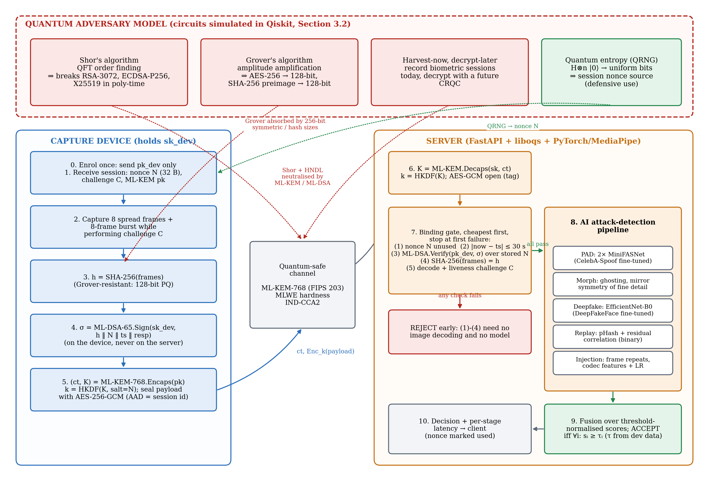
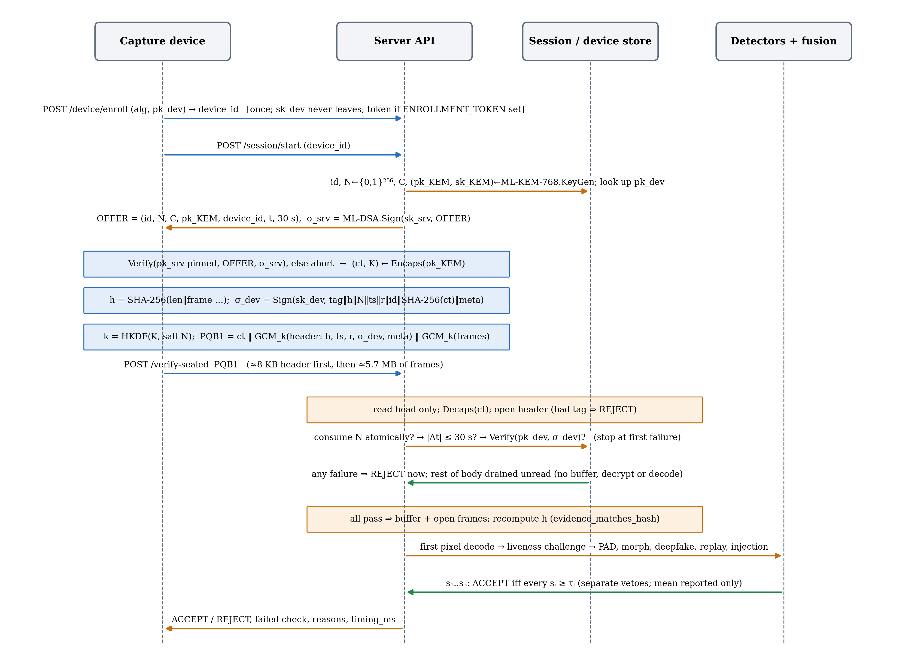

# Rejecting Invalid Biometric Submissions Before Inference

**Post-quantum transaction binding for biometric evidence screening.**
Code, data and experiment scripts for the paper of the same title
(`report/final-report/`). Vellore Institute of Technology, Vellore.

Remote identity checks (bank onboarding, e-KYC, digital ID) ask a person to
show their face to a camera and send it to a server. Two things can go
wrong. The channel is protected by RSA and elliptic-curve cryptography,
which quantum computers will break, so sessions recorded today can be
decrypted later. And even a perfectly secure channel says nothing about
whether the face in it is real: a deepfake sent over TLS is still a deepfake.

This repository implements **biometric evidence screening**
that addresses both. It checks that a face capture came unaltered from an
enrolled device, for one session, within the last 30 s, and shows none of
five attack signatures. It sends the capture over a channel built only
from post-quantum public-key primitives (ML-KEM-768, ML-DSA-65). Invalid submissions are rejected
cryptographically **before** any image is read or any model runs. It does
not match the face against a trusted identity reference, so it does not
by itself establish who the person is (see
[`docs/PROTOCOL.md`](docs/PROTOCOL.md), Section 5). Invalid requests cannot
end or use up a legitimate session, and the work any enrolled key can cause
is bounded. The protocol's security is argued informally, not formally
proven, and the biometric detectors are not robust across datasets or
against adaptive attacks; the paper reports these as limitations.



## Key features

- **Post-quantum channel with an authenticated server key.** The server
  signs each session offer, including its ephemeral **ML-KEM-768** (FIPS 203)
  key, with its ML-DSA identity key. The client checks that signature
  against the pinned server key before it encapsulates, then encrypts the
  evidence with **AES-256-GCM**.
- **Transaction binding with early rejection.** An **ML-DSA-65** (FIPS 204)
  signature, made on the capture device with a key that never leaves it,
  over the evidence fingerprint, a single-use 256-bit nonce, a timestamp, the
  liveness-challenge answer, the session id, the ML-KEM ciphertext and the
  injection-check metadata. The server checks nonce, freshness, signature
  and frame fingerprint cheapest-first and stops at the first failure, so
  forged or replayed submissions are rejected before the frames are read,
  decrypted or decoded. The exact format and check order are in
  [`docs/PROTOCOL.md`](docs/PROTOCOL.md).
- **Session safety.** Opening and closing a session require the device's
  signature. The nonce is only read by the early checks and claimed
  atomically once the request is authenticated, so invalid requests cannot
  end a session and exactly one of several concurrent copies is admitted.
  Per-device limits (3 open sessions, 12 per minute) bound the inference any
  one key can trigger.
- **Distributed trust.** Devices enrol only their public key
  (`POST /device/enroll`, optionally gated by `ENROLLMENT_TOKEN`); the server
  stores public keys and has no way to sign evidence on a client's behalf.
- **Live recording with a liveness challenge.** The dashboard records a
  4 s clip from the browser camera while the person performs a randomly
  chosen head movement (turn left, turn right or nod); the check fails
  closed if the movement cannot be measured.
- **Trained detectors, measured on public data:** MiniFASNet presentation
  attack detection, an EfficientNet-B0 deepfake detector fine-tuned on
  DeepFakeFace, and a virtual-camera (injection) classifier that relies on
  pixels rather than client-reported timestamps; plus replay and morph
  checks. ISO/IEC 30107-3 APCER/BPCER on CASIA-FASD, CelebA-Spoof, a webcam
  liveness sample and DeepFakeFace (`evaluation/`).
- **Explained decisions.** Every rejection comes with plain-language reasons
  and the values that were measured.
- **Quantum threat model, simulated.** Shor's algorithm, Grover's algorithm
  and a quantum random number generator implemented in Qiskit and run on
  ideal and noisy simulators (`report/`).

## How it works



0. **Enrol (once).** The device generates an ML-DSA keypair and sends only
   the public key.
1. **Session.** The server issues a session ID, a one-time nonce, a random
   liveness challenge and an ephemeral ML-KEM public key, all signed with its
   identity key. The client verifies that signature against the pinned
   server key.
2. **Capture.** The person records a short clip: looking at the camera,
   then performing the challenge.
3. **Bind.** On the device, the frames' SHA-256 fingerprint is signed with
   the device's ML-DSA key together with the nonce, timestamp and challenge
   answer.
4. **Seal.** The client derives a key with ML-KEM-768 and HKDF and
   encrypts the submission with AES-256-GCM.
5. **Gate.** The server decrypts, then checks nonce → freshness → ML-DSA
   signature → frame fingerprint, stopping at the first failure. Only then
   are frames decoded and the liveness challenge checked.
6. **Detect and decide.** Five detectors score the evidence. Each threshold
   is a separate veto: any detector below its own calibrated threshold
   rejects. A threshold-normalised weighted mean is reported, but it does
   not decide.
7. **Explain.** The response says why.

| Detector | What it checks |
|---|---|
| Presentation attack | RetinaFace + MiniFASNetV2 (2.7×) + MiniFASNetV1SE (4.0×), released Silent-Face-Anti-Spoofing checkpoints |
| Deepfake | EfficientNet-B0 fine-tuned on DeepFakeFace face swaps (identity-disjoint split) |
| Injection | Repeated frames, inter-frame sensor noise, 8/16-px blocking and static blocks of an 8-frame burst → logistic regression |
| Replay | Whether this exact capture was already submitted: same picture **and** same pixel-level detail (binary) |
| Morph | Double contours ("ghosting") and unnaturally symmetric fine texture left by blending two faces (signal processing, not benchmarked) |

Why post-quantum: Shor's algorithm breaks RSA and elliptic curves, and
Grover's algorithm halves symmetric key strength. Both are simulated in
[`report/scripts/quantum_experiments.py`](report/scripts/quantum_experiments.py).
Detailed design: [`docs/ARCHITECTURE.md`](docs/ARCHITECTURE.md).

## Results at a glance

Apple M3, CPU only; details in `report/final-report/QUANTUM-FINAL-REPORT-REVISED.docx`.

| | Result |
|---|---|
| Forged submission, server time: integrated / buffered / layered | 0.30 ms / 2.6 ms / 589 ms |
| Forged requests/s needed to double genuine latency (3 repeats, deployed limits) | 108 ± 4 integrated, 43.5 ± 0.7 buffered, 1.20 ± 0.01 layered (90× layered) |
| Same protocol with ECDSA-P256 instead of ML-DSA-65 | 0.49 ms, 114 ± 1 requests/s: the saving is the check order, not the signature scheme |
| Invalid requests against live sessions (6 kinds × 10) | 60/60 sessions survive; with the nonce consumed at the first check, 5 of 6 kinds end every session |
| Concurrent copies of one valid submission (k = 2, 8, 32) | exactly one admitted in 30/30 trials |
| Floods by enrolled keys (deployed limits) | 12 inferences/min per key (116 without limits); 4 keys: genuine median 6.5 s, 8 keys: 27.7 s |
| Validly signed attacks accepted | 26/60 webcam presentation attacks, 10/40 re-encoded injections, 7/10 lossless injections, 0/135 still images, 0/10 replays |
| White-box PGD (ε = 4/255) on webcam attacks | 17/20 accepted (4/20 unperturbed) |
| All post-quantum work on the server per verification | 6.5 ms (1.1% of server time) |
| PAD (MiniFASNet), CASIA-FASD test | worst-species APCER 0.7%, BPCER 14.4% [8.4, 21.4] by subject, EER 6.3% (heuristic baseline: 44.8%) |
| PAD cross-dataset AUC: CelebA-Spoof / webcam video | 0.782 / 0.782 |
| Deepfake (EfficientNet-B0), DFF unseen identities | AUC 0.930 on the training generator; does not transfer to unseen diffusion generators |
| Injection classifier vs timing heuristic (forged jitter) | APCER 4.0% vs 100% (25→30 fps file), BPCER 6.4% |
| Real OBS Virtual Camera (4 people live, 150 attack clips) | BPCER 0/40; attacks accepted: 24–25 fps files 0–17%, 30 fps files 40–100% |

The detector results are limitations, not a robust identity-verification
solution: the system screens evidence and does not match faces to an identity.


## Getting started

Two ways to run the server: **Docker**, which isolates the liboqs build and
gives the same image on every machine, or **native**, which is slightly
faster to iterate on. The dashboard always runs natively, because it uses
your browser's camera.

### Option A: Docker server + native dashboard (macOS)

**Prerequisites:** [Docker Desktop](https://www.docker.com/products/docker-desktop/)
installed and running (the whale icon in the menu bar), Python 3.11, and at
least 10 GB of free disk space. Works natively on Apple Silicon and Intel
Macs.

**1. Configure.** From the repo root:

```bash
cp .env.example .env
```

`.env` holds every setting (algorithms, thresholds, port) with working
defaults; no edits are needed to get started.

**2. Build and start the server.**

```bash
docker compose up --build
```

`docker compose` reads `docker-compose.yml`, which builds `Dockerfile`: a
Debian-slim image with the liboqs toolchain (cmake, ninja, gcc) that
installs `requirements.txt` and compiles liboqs. The first build takes a few
minutes; later builds are cached unless `requirements.txt` or the
`Dockerfile` change. The server then listens on `localhost:8000`. Wait for
`Application startup complete`. To run it in the background, use
`docker compose up --build -d` and follow the logs with
`docker compose logs -f server`.

**3. Check it,** in a new terminal:

```bash
curl http://localhost:8000/health
```

Expect `{"status":"ok","kem_alg":"ML-KEM-768","sig_alg":"ML-DSA-65","liboqs_ready":true}`.
The interactive API docs are at `http://localhost:8000/docs`.

**4. Start the dashboard:**

```bash
python3.11 -m venv .venv && source .venv/bin/activate
pip install -r requirements-client.txt
streamlit run client_demo/streamlit_app.py
```

This opens `http://localhost:8501`. The sidebar should say **Server online**.
With only `requirements-client.txt` installed it says **Client channel:
plaintext**: evidence goes to the server's plaintext `/verify` endpoint. The
demo is the same; only the wire format differs. For the full post-quantum
channel on the client too (**Client channel: sealed**), also build liboqs on
the Mac:

```bash
brew install cmake ninja openssl
pip install -r requirements.txt -r requirements-client.txt
```

**5. Build the demo samples and run the self-check:**

```bash
pip install scikit-image
python scripts/make_demo_assets.py        # writes demo_assets/attacks/ (gitignored)
python scripts/demo_check.py --explain    # expects "12/12 scenarios behaved as expected"
```

The demo samples are single images and short clips, which a production
server rejects as malformed (a live capture is exactly 8 + 8 frames). For
rehearsals set `DEMO_MODE=true` and `ALLOW_SAMPLE_UPLOADS=true` in `.env`
and restart the server; `demo_check.py` tells you if they are missing.
Live webcam capture works either way.

**Managing the container:**

```bash
docker compose ps                  # status
docker compose logs -f server      # logs
docker compose down                # stop and remove
docker compose up -d --force-recreate   # apply .env changes
```

`crypto/`, `detection/`, `binding/`, `server/`, `evaluation/` and
`demo_assets/` are mounted into the container and the server runs with
`--reload`, so code edits apply without a rebuild. Only dependency changes
need `docker compose up --build`.

**Troubleshooting (macOS + Docker):**

| Symptom | Fix |
|---|---|
| `Cannot connect to the Docker daemon` | Open Docker Desktop and wait until it is running |
| Container *unhealthy*, logs show `input/output error` | Your Mac's disk is (nearly) full and Docker's VM can't write. Free space, then quit and reopen Docker Desktop |
| Build fails or hangs at the liboqs/cmake step | Docker Desktop → Settings → Resources: more CPU/memory, then `docker compose up --build` |
| `port is already allocated` on 8000 | Something else owns port 8000 (often a native `uvicorn`): find it with `lsof -iTCP:8000 -sTCP:LISTEN` and `kill` it, or `docker compose down` |
| `curl: (7) Failed to connect` right after starting | Still starting; wait for `Application startup complete` |
| Dashboard says *Server unreachable* | Check `curl http://localhost:8000/health`; `API_BASE_URL` in `.env` must be `http://localhost:8000` |

### Option B: fully native (no Docker)

```bash
brew install cmake ninja openssl
python3.11 -m venv .venv && source .venv/bin/activate
pip install -r requirements.txt -r requirements-client.txt
cp .env.example .env

./scripts/run_server.sh                       # terminal 1: server on :8000
./scripts/run_client.sh                      # terminal 2: dashboard on :8501
```

The scripts always use the project's `.venv`. Running plain `uvicorn` outside
the activated venv uses a different Python and fails with `ModuleNotFoundError`.

Full walkthrough: [`docs/SETUP_MACOS.md`](docs/SETUP_MACOS.md).

### Windows

liboqs needs Visual Studio Build Tools to compile natively, so the server
runs in Docker (`docker compose up --build`) and only the dashboard runs
natively (`pip install -r requirements-client.txt`, plaintext channel).
See [`docs/SETUP.md`](docs/SETUP.md).

## Using the dashboard

| Tab | What you do | Expected result |
|---|---|---|
| **Live Capture** | Start a session, press START on the video, then **Record**: look at the camera, then do the challenge shown on the video. Verify. | ✅ ACCEPT for a real, live person |
| **Simulate Attack** | Pick a pre-made sample (genuine, replay, printed photo, screen replay, morph, deepfake, injection) or upload a file | ❌ REJECT, naming the detector and why |
| **Tamper with Protocol** | Break one protocol rule on a genuine capture: swapped frames, flipped bit, stale timestamp, reused nonce, wrong answer | ❌ REJECT by the cryptographic layer in about 1 ms |

Each result shows the post-quantum channel used, every binding check, each
detector's score and verdict, and a **"Why was this rejected?"** list. A
step-by-step presenter's guide is in [`docs/GUIDE.md`](docs/GUIDE.md).

## Project structure

```
crypto/         ML-KEM / ML-DSA wrappers (liboqs), AES-256-GCM channel, RSA/ECDSA baseline
binding/        Transaction binding gate (cost-ordered, short-circuit)
detection/      Detectors (MiniFASNet, EfficientNet-B0, injection classifier, replay, morph), face detector, liveness, fusion
server/         FastAPI app: device registry, sessions, sealed verification pipeline, explanations
client_demo/    Device identity (ML-DSA key), Streamlit dashboard, clip recorder, API client
evaluation/     Data fetch, training/fine-tuning, PAD/deepfake/injection benchmarks, ISO 30107-3 metrics
scripts/        make_demo_assets.py (demo samples), demo_check.py (self-check)
tests/          134 unit and API tests
report/         Final report, figures, raw data, experiment scripts (incl. Qiskit circuits)
docs/           Architecture, setup guides, study guide, original specification
datasets/       Download instructions only (datasets are not committed)
demo_assets/    Generated demo samples (gitignored) and their description
```

## API

| Endpoint | Purpose |
|---|---|
| `GET /health` | Status, algorithms, liboqs readiness |
| `GET /server/identity` | The server's ML-DSA identity public key, which clients pin |
| `POST /device/enroll` | `{sig_alg, public_key}` → `device_id`; registers a device's ML-DSA public key |
| `POST /session/start` | `{device_id, timestamp, request_nonce, signature}` (signed by the device) → nonce, challenge, ML-KEM public key, signed by the server identity key. HTTP 429 beyond the per-device limits |
| `POST /session/{id}/verify-sealed` | Binary PQB1 envelope (ML-KEM ct, sealed header, sealed frames). Header checked first; frames read only if the signature is valid → liveness → AI → decision + explanations |
| `POST /session/{id}/verify` | Plaintext variant for unit tests only; 404 unless `ALLOW_PLAINTEXT_VERIFY=true` |
| `POST /demo/reset-replay-store` | Clear replay memory between rehearsals (`DEMO_MODE=true` only) |
| `DELETE /session/{id}` | Close a session early; needs `X-Session-Close-Signature` from the device. Unused sessions expire after 120 s |

## Testing and reproducibility

```bash
pytest tests/ -q                                 # 155 tests; liboqs-dependent ones skip without liboqs
python evaluation/fetch_data.py                  # exact public subsets (HTTP range requests)
python evaluation/finetune_pad.py && python evaluation/benchmark_pad.py
python evaluation/train_deepfake.py && python evaluation/benchmark_deepfake.py
python evaluation/train_injection.py             # injection classifier + its evaluation
python report/scripts/distributed_experiments.py # two-process latency and rejection cost: integrated / buffered / layered x ML-DSA / ECDSA
python report/scripts/flood_experiment.py        # forged-request rate needed to double genuine latency (3 repeats)
python report/scripts/signed_attacks.py          # public-data attacks signed by the enrolled device: which check rejects each
python report/scripts/malicious_client.py        # session safety, concurrency, authenticated clients, enrolled-key floods (with ablations)
python evaluation/cluster_ci.py                  # intervals by subject / video / person
python report/scripts/results_figures.py         # figures from the saved results
```

The quantum experiments need Qiskit in a separate environment
(`pip install -r report/requirements-report.txt`); see Appendix A of the report.

## Limitations

- **PAD across cameras.** MiniFASNet is strong on CASIA-FASD but loses
  accuracy on CelebA-Spoof and webcam video (see the report, Section 4.1);
  prints and paper outlines in the webcam sample were accepted.
- **Deepfakes from unseen generators.** The EfficientNet-B0 detector
  separates real faces from the face swaps it was trained on, but not from
  diffusion-model fakes it has never seen.
- **Injection.** A lossless video file at the camera's own frame rate is
  pixel-identical to a camera stream and is not detected. The injection
  benchmark is an emulation on real webcam footage, checked with a real
  OBS Virtual Camera on macOS: 30 fps files get through far more often.
- **Morph detector** is still signal processing and is not benchmarked
  (public morph datasets require an access request).
- **Screening, not identification.** A valid device signature proves the
  bytes came from an enrolled key. It does not prove that a real camera
  captured them (no hardware attestation), and there is no face match
  against a trusted identity reference.
- **Enrollment is trust-on-first-use** (or a shared `ENROLLMENT_TOKEN`). A
  deployment would tie `POST /device/enroll` to onboarding or hardware key
  attestation and rate-limit per device. The server key is pinned on first
  use unless `PQBIO_SERVER_PUBKEY` is distributed out of band.
- **Authenticated malicious clients.** An enrolled key passes every
  cryptographic check by definition. Against such a client the protocol
  bounds the shape of a submission and the work per device (one inference
  per session, 12 sessions a minute), but whether attack content is caught
  depends on the detectors alone, and white-box adversarial perturbations
  are measured in the report (Section 4.6).
- **liboqs is required on the client** now that the client signs.
- **In-memory state.** Sessions, devices and replay memory live in one
  process; a multi-server deployment would need a shared store.
- **Quantum results are simulations** on a parametric noise model.

## Future work

- Larger and more diverse PAD training data (and domain adaptation) for
  webcam conditions; deepfake training across several generator families.
- Hardware-backed device keys (TEE / secure element) with attestation at
  enrollment; hybrid X25519 + ML-KEM-768.
- QRNG-sourced nonces with HKDF conditioning; Shor/Grover on IBM hardware.

## Documentation

| Document | For |
|---|---|
| [`docs/GUIDE.md`](docs/GUIDE.md) | Presenter's guide: running the demo, showing each ACCEPT/REJECT |
| [`docs/VIRTUAL_CAMERA_TEST.md`](docs/VIRTUAL_CAMERA_TEST.md) | Step-by-step real virtual-camera (OBS) injection test |
| [`docs/PROTOCOL.md`](docs/PROTOCOL.md) | Exact protocol: keys, signed and encrypted fields, wire format, server check order, decision rule |
| [`docs/ARCHITECTURE.md`](docs/ARCHITECTURE.md) | Verification flow, detectors, security properties |
| [`docs/SETUP_MACOS.md`](docs/SETUP_MACOS.md), [`docs/SETUP.md`](docs/SETUP.md) | Detailed setup (macOS, Windows) |
| [`docs/STUDY_GUIDE.md`](docs/STUDY_GUIDE.md) | Background: PQC, algorithms, detectors, terminology |
| [`report/final-report/QUANTUM-FINAL-REPORT-REVISED.docx`](report/final-report/QUANTUM-FINAL-REPORT-REVISED.docx) | The paper (earlier drafts in `report/archive/`) |
| [`CHANGELOG.md`](CHANGELOG.md), [`CLAUDE.md`](CLAUDE.md) | Change history, contributor conventions |
